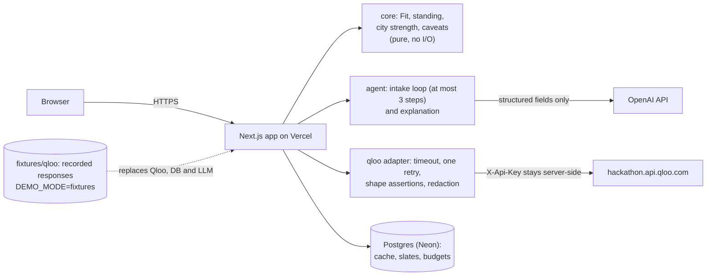
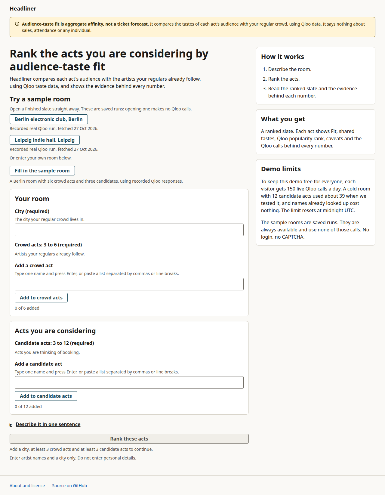
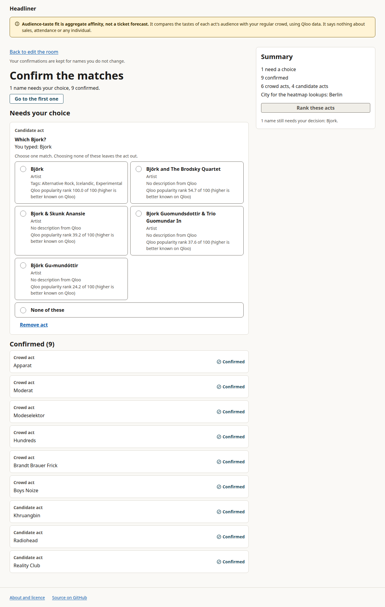
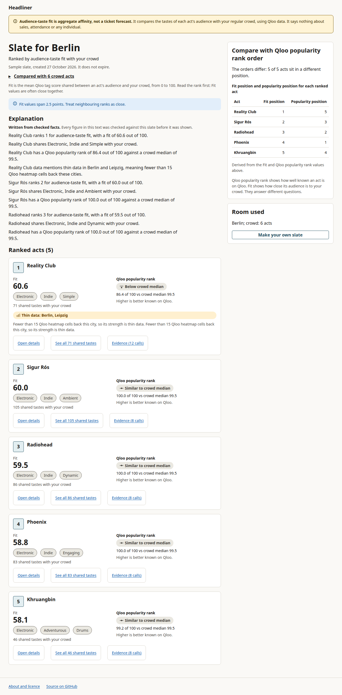
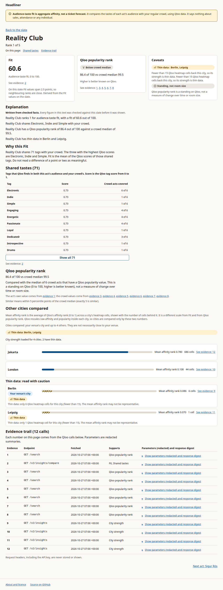
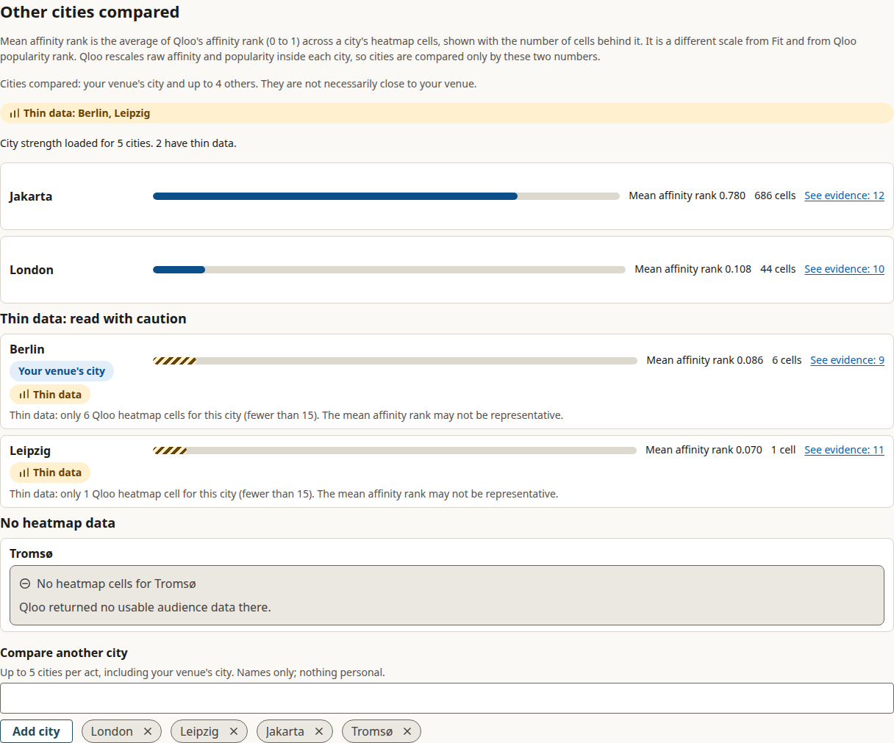
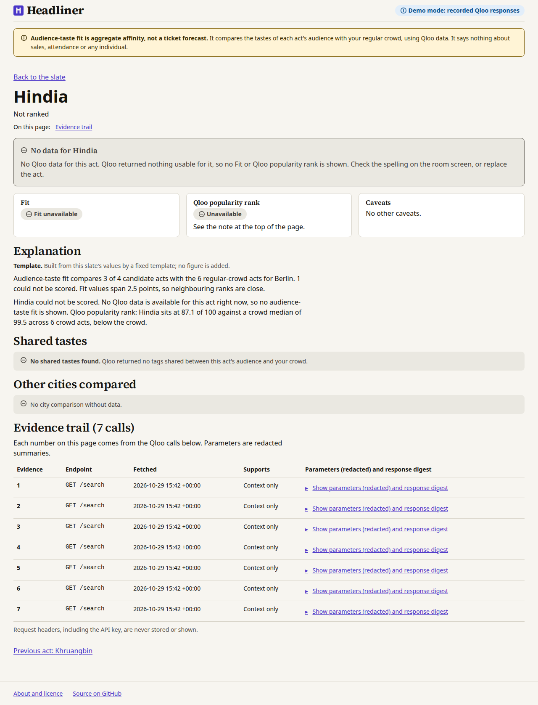

# Headliner

An agent that ranks the acts an independent venue is considering and shows, with checkable Qloo evidence, how well each act's audience tastes fit the venue's regular crowd.

> Aggregate affinity, not a ticket forecast.

Live demo: <https://headliner-ai.vercel.app> (no login, no CAPTCHA). Built for the Qloo Agentic Hackathon. Licence: MIT.

## Problem

Independent venue talent buyers, promoters, festival bookers and artist managers decide which acts to book for a room whose regular crowd they know well. We believe that fit between an act's audience and the room is mostly judged by instinct, and that a miss means an empty room. This is an inference from the way booking is described in trade writing, not the result of interviews we ran; treat it as a hypothesis, not a finding.

What Headliner replaces is the guess, not the booker. It gives a second, checkable opinion on one narrow question: how close are the tastes of this act's audience to the tastes of my regulars?

## Solution

The booker describes the room (a city and 3 to 6 regular-crowd artists, typed or as one sentence the agent reads) and adds up to 12 candidate acts. Headliner returns a ranked slate:

- **Audience-taste fit ("Fit", 0 to 100).** The mean Qloo tag score shared between a candidate's audience and the whole crowd, computed by code from one Qloo compare call per candidate. Fit values sit in a narrow band, so rank leads and close values are called close. Definition: [ADR 0013](docs/adr/0013-fit-formula.md).
- **Evidence trail.** Every number links to the redacted Qloo requests behind it (endpoint, parameters, a digest of the response). The API key header is never stored or shown.
- **Audience standing.** Labelled "Qloo popularity rank": how well known the act is on Qloo, next to the crowd's median. It is not capacity fit and not momentum (see Honest limits).
- **City strength, loaded lazily.** For the act you open, mean `affinity_rank` and the number of heatmap cells for the venue's city and others you choose; fewer than 15 cells is flagged as thin data.
- **Shareable slate.** A read-only link, kept 30 days, that shows resolved names and results and nothing the booker typed.
- **Honest states.** Ambiguous names block ranking until the booker picks the match; an act Qloo has nothing usable for is shown as "No data", never as a zero.

Scores are computed by code. The language model only reads a sentence into a room and phrases fields that are already in the slate; it never computes or invents a number (ADR 0009).

## Why now

Qloo exposes taste data about audiences, not only about individual items, through an API an agent can call. That fits the booking decision, which is a comparison of two audiences. The comparison needs several coordinated calls (resolve names, compare each candidate with the crowd, read a city heatmap), checks on what comes back, and a plain-language account the booker can verify. That is work for a small agent over a deterministic pipeline, not for a chat box, and it is why the language model sits only at the two edges.

## Architecture



The same diagram as text, and the requirements, data model and agent constants, are in [docs/architecture.md](docs/architecture.md).

Pipeline for one slate:

1. **Resolve.** Each typed name is searched on Qloo. Exact matches are accepted; an ambiguous or missing name goes to a confirmation screen and ranking waits for the booker.
2. **Compare.** One list compare per candidate with the whole crowd on side A (a slate of 6 crowd acts and 12 candidates is 30 Qloo calls: 18 searches and 12 compares).
3. **Score.** Pure functions in `packages/core` compute Fit, Qloo popularity rank, caveats and the ranking, and attach the Evidence for every number.
4. **City strength, lazily.** Heatmaps are fetched only for the act the reader opens.
5. **Explain.** A templated explanation built from slate fields is always available; the model may rephrase it, and a grounding check rejects any number or name that is not in the slate (the template is then shown).

Decisions (each is a short ADR):

| ADR | Decision |
|---|---|
| [0001](docs/adr/0001-modular-monolith.md) | Modular monolith in TypeScript on Next.js; `core` imports no framework or I/O |
| [0002](docs/adr/0002-postgres-cache-and-slates.md) | Postgres for the Qloo cache, 30-day slates and budgets |
| [0003](docs/adr/0003-api-and-contracts.md) | Route handlers, shared zod schemas, hard input limits |
| [0004](docs/adr/0004-synchronous-pipeline.md) | Request-bounded pipeline, lazy city detail |
| [0005](docs/adr/0005-frontend.md) | App Router, server components, WCAG AA |
| [0006](docs/adr/0006-scaling-story.md) | Stateless tier; the cache is the scaling lever |
| [0007](docs/adr/0007-reliability.md) | Timeouts, one retry, partial results, stale cache |
| [0008](docs/adr/0008-security-and-abuse.md) | Server-side key, per-IP and global budgets, hardened shared pages |
| [0009](docs/adr/0009-agent-shape.md) | Deterministic pipeline with an LLM at the edges |
| [0010](docs/adr/0010-observability.md) | JSON logs and an uptime check |
| [0011](docs/adr/0011-delivery-testing-demo-mode.md) | Fixture-replay tests and the zero-key `DEMO_MODE` |
| [0012](docs/adr/0012-qloo-access-via-rest.md) | REST adapter over `hackathon.api.qloo.com` |
| [0013](docs/adr/0013-fit-formula.md) | The Fit formula, standing and city strength definitions |

## Demo

Live: <https://headliner-ai.vercel.app>. Two pre-warmed sample rooms open straight to a stored slate with no Qloo call:

- <https://headliner-ai.vercel.app/s/sample-berlin-electronic> (Berlin, 6 crowd acts, 5 candidates)
- <https://headliner-ai.vercel.app/s/sample-leipzig-indie> (Leipzig, 4 crowd acts, 5 candidates)

Or type your own room, or describe it in one sentence. Screenshots below were captured on 29 Oct 2026 from the production site (live mode, light mode): the room setup page, the match confirmation (the sample Berlin room plus the typed name "Bjork"), and the stored sample Berlin slate with its Reality Club act detail and cities section. The empty-state screenshots are the exception: they come from a `DEMO_MODE=fixtures` build (they show the "Demo mode: recorded Qloo responses" badge) because no no-data act is stored on production.

**Room setup** ([1280 px](docs/screenshots/room-setup-1280.png), [390 px](docs/screenshots/room-setup-390.png))



**Match confirmation.** An ambiguous name ("Bjork") blocks ranking until the booker picks the Qloo match or leaves the act out ([390 px](docs/screenshots/match-confirmation-390.png)).



**Slate.** Ranked acts, each with a rank numeral, Fit, shared tastes count, Qloo popularity rank and the thin-data caveat, with the Qloo popularity order comparison and a collapsed Explanation section ([768 px](docs/screenshots/slate-768.png), [390 px](docs/screenshots/slate-390.png), [360 px](docs/screenshots/slate-360.png)).



**Act detail with the evidence trail** ([768 px](docs/screenshots/act-detail-768.png), [390 px](docs/screenshots/act-detail-390.png), [360 px](docs/screenshots/act-detail-360.png)).



**Thin-data flag.** Cities with fewer than 15 heatmap cells are flagged and grouped apart; the act detail shows it for each city ([390 px](docs/screenshots/thin-data-390.png)).



**Empty state** (fixtures build, not production). An act Qloo has no usable data for says so and shows no number ([390 px](docs/screenshots/empty-state-390.png)).



## How to run

Needs Node 24 or newer.

### With no keys: `DEMO_MODE=fixtures`

No `.env`, no database, no Qloo key and no LLM key. Every Qloo answer is replayed from the recordings in `fixtures/qloo/`, and the server makes no outbound network calls.

```bash
git clone https://github.com/swapnaliss/headliner.git && cd headliner
npm ci
export DEMO_MODE=fixtures
npm run build -w apps/web
ROOM_DIR=apps/web/test/fixtures                # the recorded room lives here
PORT=3000 npm run start -w apps/web &            # or: npm run dev
curl -s localhost:3000/api/health                # {"ok":true,"mode":"fixtures",...}
curl -s -X POST localhost:3000/api/slates \
  -H 'content-type: application/json' \
  --data @"$ROOM_DIR/room.json"                  # ranked acts, each number with its Evidence
```

Open <http://localhost:3000> for the UI. `room.json` in `apps/web/test/fixtures` is a recorded room (Berlin, six regular-crowd acts, four candidates). An act with no recording comes back as an honest `no-data` result, never an invented one. `scripts/demo-mode-smoke.sh` runs this sequence and fails on any error. Hackathon Qloo keys deactivate after judging, so this is the path that keeps working.

### Live mode

`DEMO_MODE=live` needs `QLOO_API_KEY` and `DATABASE_URL`; `OPENAI_API_KEY` is optional (without it intake and explanation use the deterministic path). Optional: `QLOO_BASE_URL`, `LLM_MODEL` (default `gpt-5-nano`), `BUDGET_IP_QLOO_CALLS`, `BUDGET_IP_LLM_TOKENS`, `BUDGET_GLOBAL_QLOO_CALLS`, `BUDGET_GLOBAL_LLM_TOKENS`, `BUDGET_SALT`. Apply the schema with `npm run db:migrate`. The Qloo key works only against `hackathon.api.qloo.com`, is read on the server only and is never logged.

### Tests and checks

```bash
npm test                              # unit and replay tests, fixtures only
npm run eval:agent                    # agent evals from recorded traces, offline
npm run proof                         # re-computes the two measured checks from recordings
npm run check                         # lint, typecheck, test, build
./scripts/landing-checks.sh           # secret scan plus the full chain CI runs
```

## Measured results

All figures replay from recorded real Qloo responses, are small samples, and carry no preset pass line. Aggregate affinity, not a ticket forecast.

| Check | Result | Sample and limits | Evidence |
|---|---|---|---|
| Home-city check | **12 of 15** acts have their documented home city as the strongest by mean `affinity_rank` (strict reading, at least 15 cells: also 12 of 15). Misses: BTS, BLACKPINK, IU (Seoul is second for all three; Jakarta is first). | 15 hand-picked acts, 5 cities, 3 continents, 3 acts per city, set fixed before any heatmap was requested. Heatmaps are rescaled per city; Qloo popularity may influence results; a home city is not where listeners live. | [home-city-check.md](docs/evidence/home-city-check.md) |
| Fit sanity | **11 of 12** same-genre candidates score above their crowd's off-genre control (electronic 4 of 4, hip-hop 4 of 4, jazz 3 of 4). Margins are small (jazz -0.2 to +0.8, hip-hop +0.4 to +1.3, electronic +1.3 to +4.0 points). | 3 crowds, 12 candidates, one control each; genre labels are the author's. The formula was not changed after seeing the numbers. | [fit-sanity.md](docs/evidence/fit-sanity.md) |
| Agent evals | **106 cases, 1,391 assertions, 0 failed**: ground truth, trajectories, injection corpus, tool failures, prompt-injection set. | Replays of 39 recorded intake traces and 3 explanation replies from `gpt-5-nano`, plus hand-written stand-in models; tests the guardrails, not that a model never misbehaves. Known gaps: a lowercase invented act name and a real slate figure attached to the wrong meaning are not caught. | [agent-evals.md](docs/evidence/agent-evals.md) |

Qloo latency and call counts (one workstation, one afternoon, 2026-10-26; percentiles with n under 20 are indicative only):

| Endpoint | n | Median | p95 | Evidence |
|---|---|---|---|---|
| `/search` | 16 | 335 ms | 1,634 ms | [qloo-latency.md](docs/evidence/qloo-latency.md) |
| `/v2/insights/compare` | 5 | 388 ms | 1,631 ms | same |
| `/v2/insights` heatmap | 10 | 704 ms | 1,989 ms | same |
| `/v2/insights` (artists) | 3 | 3,420 ms | 4,952 ms | same (not on the slate path) |

A cold 6-crowd by 12-candidate slate took 4,988 ms and 5,555 ms on the Qloo side (2 runs). Qloo answered HTTP 429 on 9 of 39 calls in each run; every one succeeded on the single retry, so a cold slate costs 39 live calls, not 30 ([qloo-cold-slate.md](docs/evidence/qloo-cold-slate.md)).

Production, single observations (n=1, 2026-10-28, not percentiles): one sentence read into a room by the model in 3.89 s using 844 tokens (0.0000674 USD); the resulting slate came back in 0.47 s because every name was already cached, so it is not a cold-slate time ([m3-gate.md](docs/evidence/m3-gate.md)). A sample page after more than 8 minutes idle answered in 1.72 s, from one client location ([m2-gate.md](docs/evidence/m2-gate.md); before and after the cold-start fix in [m2-06-cold-start.md](docs/evidence/m2-06-cold-start.md)).

## Honest limits

- **Approach.** Headliner calls Qloo through a REST adapter over `hackathon.api.qloo.com` with typed methods named after the harness workflows, not through the Qloo harness ([ADR 0012](docs/adr/0012-qloo-access-via-rest.md)). We checked the harness as a library: `@qloo/qloo-harness@0.1.26` imports as an ES module and has an in-process executor, but it is a large terminal-agent runtime, ESM-only, its result envelope differs from the REST body, and one live call through it was not attempted, so equivalence is not claimed ([harness-check.md](docs/evidence/harness-check.md)). The organiser question about whether the harness is the expected surface has no recorded answer in this repository.
- **No momentum.** `/v2/trending` returns an empty result for a signal entity in this environment ([qloo-latency.md](docs/evidence/qloo-latency.md)), so Headliner makes no momentum or growth claim. Audience standing is the Qloo popularity rank, labelled so; it is not a capacity fit.
- **City comparisons.** Qloo rescales heatmap affinity and popularity inside each city, so cities are compared only by mean `affinity_rank` plus the cell count; under 15 cells is thin data and says so.
- **Not a forecast.** Fit is aggregate audience-taste affinity. It says nothing about ticket sales, attendance or capacity, and nothing about any individual. No personal data is collected or sent to Qloo.
- **Small, hand-picked checks.** 12 of 15 and 11 of 12 are small samples without confidence intervals; the three Seoul misses show that the home-city measure is not clean.
- **Fit can read high on few shared tastes.** Fit is the mean Qloo tag score over the tags an act's audience shares with the crowd, so an act that shares only a few tags can score above one that shares many. One production observation (n=1, 2026-10-30, a Portland folk-club room with 5 crowd acts and 4 candidates): Dua Lipa ranked first with Fit 72.9 on 8 shared tastes, ahead of Big Thief at 59.7 on 94. The slate prints the shared-taste count beside Fit so the reader can weigh it. The only overlap caveat today is for a single shared tag; there is no minimum-overlap rule, and how often this happens is not measured ([fit-few-shared-tastes.md](docs/evidence/fit-few-shared-tastes.md)).
- **Model prose.** Explanations are built from a fixed template over slate fields; the model may rephrase it, and a grounding check rejects any number or name that is not in the slate, in which case the template is shown. The grounding check accepted recorded model prose at slate scope for two slates (Leipzig and Berlin, one recording each) and at act scope for one Berlin act (one recording); a Leipzig act-scope reply was rejected and that page shows the deterministic template. These are single recordings, not a rate ([m3-gate.md](docs/evidence/m3-gate.md), [Berlin slate reply](fixtures/agent/explain/model-reply--berlin-slate.json), [Berlin act reply](fixtures/agent/explain/model-reply--berlin-act.json)). The whole agent path was observed on production once (n=1), and the fallback with the LLM budget at 0 was proven on a local production build only.
- **Repeated explanation calls.** A slate viewed through both the API and the page can trigger a second model call, because the explanation cache is per server process and the two requests can run on different serverless instances. Recorded cost: 0.000126 USD per call, plus the viewer's per-IP token budget ([m3-gate.md](docs/evidence/m3-gate.md)). Accepted limitation.
- **Model deprecation.** `gpt-5-nano`, the default model, is listed as deprecated by OpenAI (removal 2026-12-11). `LLM_MODEL` switches model with no code change; if the model is removed the agent paths fall back to the deterministic path.
- **Accessibility.** axe reports 0 serious or critical issues and a keyboard-only journey passes, but no screen-reader pass, 200% zoom or text-spacing check, or 320 px check has been done. After a client-side navigation the browser tab title can be blank for a moment before it settles.
- **Keys and recordings.** Qloo hackathon keys deactivate after judging, so the hosted demo's live mode ends then and `DEMO_MODE=fixtures` remains. Redistribution of the recorded Qloo responses in `fixtures/` is not confirmed by the organiser ([fixtures/qloo/README.md](fixtures/qloo/README.md)); they are real recorded responses, kept to what the tests and demo need.
- **Limits in the product.** 12 candidate acts, 6 crowd acts, 5 cities, names up to 80 characters. Per-IP daily demo limits (150 Qloo calls and 20,000 model tokens per UTC day; global 2,000 and 100,000) are defaults in `packages/budgets/src/config.ts`; past a limit stored slates still open and the app serves cached data only.
- **Not measured.** No human stopwatch run of the core journey, no real production HTTP 429, and the cold production slate's retry counts.

## Future vision

Season-long programming plans, multi-venue circuits, a shared view for artists and agents choosing tour cities, then other live categories such as comedy and sports.

## Licence

MIT, see [LICENSE](LICENSE).
